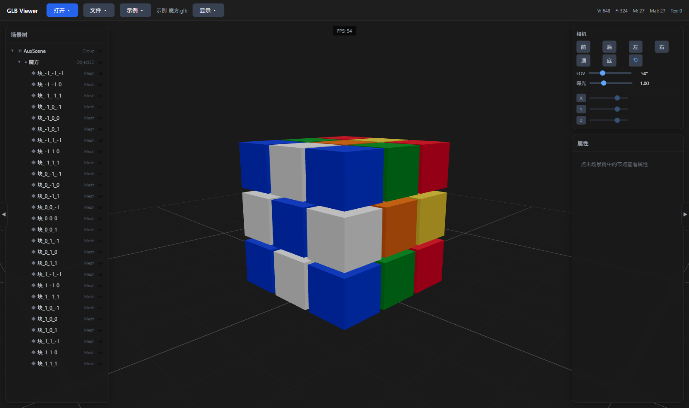
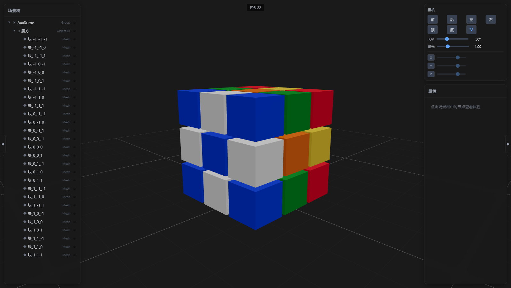

# GLB Viewer

本地 GLB 模型查看器——基于 **Electron + React + Three.js (React Three Fiber)** 构建的桌面应用,完全离线运行,无需联网。



## 功能特性

- **离线本地查看** —— 模型完全在本地解析与渲染,不上传任何数据
- **拖拽打开** —— 将 `.glb` 文件直接拖入窗口即可查看
- **完整格式支持**
  - `.glb`(二进制 glTF)
  - `.gltf`(JSON glTF,通过文件对话框打开时会自动打包其外部 `.bin` / 纹理资源)
  - 压缩扩展:**Draco**、**KTX2 (Basis Universal)**、**Meshopt**
- **场景树面板** —— 查看模型层级结构,点击节点定位
- **属性面板** —— 检视选中节点的名称、类型、位置/旋转/缩放、材质、纹理等信息
- **相机面板** —— 调整视角、投影方式、背景色等
- **动画播放** —— 播放内嵌的骨骼/形态/节点动画,可控制播放/暂停、倍速
- **渲染模式切换** —— 线框 / 法线 / 深浅等调试视图
- **内置示例模型** —— 环结、魔方、星球系统、阶梯地形,一键加载
- **最近打开记录** —— 快速重新打开历史文件
- **便携式单文件** —— Windows 免安装,拷贝即用



## 快速开始

### 下载安装(Windows 用户)

前往 [Releases](https://github.com/mcpolo1976/glb-viewer/releases) 下载便携版:

- `GLBViewer-Windows-x64.exe` —— 单文件便携版,双击运行

> 提示:未签名程序首次运行时,Windows SmartScreen 可能提示"未知发布者",选择"更多信息 → 仍要运行"即可。

### 从源码开发

**环境要求:** Node.js 20+,pnpm 11

```bash
# 安装依赖
pnpm install

# 开发模式(热更新)
pnpm dev

# 类型检查
pnpm typecheck

# 构建 Windows 便携版 → release/GLBViewer-Windows-x64.exe
pnpm build
```

## 技术栈

| 层 | 技术 |
|----|------|
| UI 框架 | React 19 + TypeScript |
| 3D 渲染 | Three.js、React Three Fiber (R3F) |
| 资产解码 | GLTFLoader + DRACOLoader + KTX2 (Basis) + Meshopt |
| 桌面壳 | Electron |
| 状态管理 | Zustand |
| 构建工具 | Vite + electron-builder |

## 使用示例

1. 打开应用后,**拉入 `探索一个 .glb 模型`** 的示例文件,或点击工具栏「示例」选择内置模型;
2. 在 **场景树** 中点击节点查看其层级与属性;
3. 模型带动画时,底部 **动画栏** 会显示播放/暂停与进度控制;
4. 通过 **相机面板** 切换透视/正交视图与背景。

## 许可证

ISC